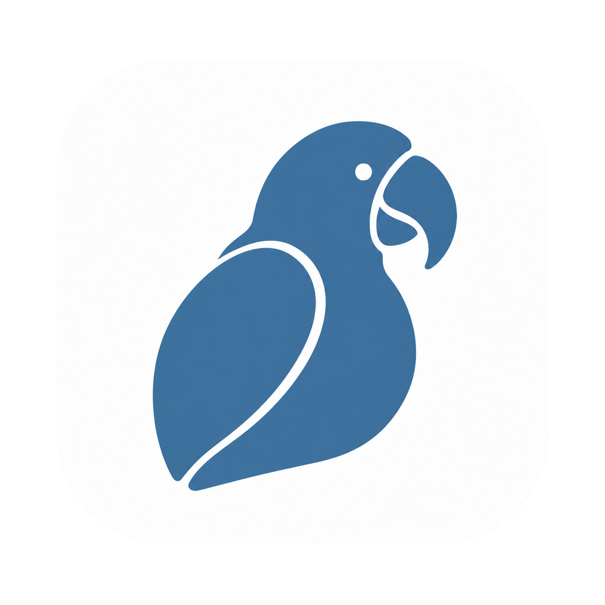
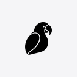

# Parrot

[English](./README.md) · [简体中文](./README.zh-CN.md) · [日本語](./README.ja.md) · [Deutsch](./README.de.md) · [Français](./README.fr.md)

macOS / iOS 向けのオープンソース翻訳・OCR ツール。選択したテキストの翻訳、スクリーンショットからの文字認識、辞書検索、複数エンジンの比較、プラグインによる LLM 連携に対応しています。

[最新リリースをダウンロード](https://github.com/korbinjoe/parrot/releases/latest)

<p align="center">
  
  
</p>

## 対応プラットフォーム

- **macOS 13 以降**：グローバルショートカットとフローティング翻訳パネルを備えたメニューバーアプリ。Releases から Apple silicon 用 DMG / ZIP を入手するか、ローカルで `build/Parrot.app` をビルドしてください。
- **iOS 17 以降**：SNS の閲覧・文章作成アシスタントと Quick Lens OCR。Xcode プロジェクトを生成し、`ParrotiOS` スキームを実行します。[操作プロトタイプ](./docs/mockups/ios-social-assistant/index.html)も参照してください。

## 機能

| 機能 | 操作方法 |
| --- | --- |
| 選択テキストの翻訳 | `⌥D`、メニュー、PopClip |
| 辞書検索 | `⌥E`、メニュー、PopClip |
| スクリーンショットの OCR・翻訳 | `⌥S` またはメニュー |
| 入力テキストの翻訳 | `⌥A` またはメニュー |
| 複数エンジンの比較 | 有効なプロバイダーの結果を自動集約 |
| 用語集 | 設定 → 用語；[ガイド](./docs/terminology.md) |
| 履歴・お気に入り | 翻訳の保存・検索；パネルの ⭐ |
| 音声読み上げ | 原文・訳文の読み上げ；パネルの 🔊 |
| JavaScript プラグイン | LLM・辞書を追加；[開発ガイド](./docs/plugin-development.md) |
| PopClip 連携 | `examples/Parrot.popclipext` をインストール |
| URL 連携 | `parrot://translate?text=` / `parrot://lookup?text=` |

## エンジンと認証情報

Google Translation LLM、DeepL、OpenAI、OpenCode Go、Microsoft、Tencent、Baidu、Youdao、Caiyun、DeepSeek、Gemini、Groq、Ollama、Qwen、Doubao、Kimi、GLM、SiliconFlow などを内蔵しています。全一覧と認証情報の形式は[エンジンガイド](./docs/engines.md)を参照してください。

API キーは「設定 → キー」で入力します。ローカルの認証情報は `~/Library/Application Support/Parrot/secrets.json` に権限 `0600` で保存されます。`OPENAI_API_KEY`、`DEEPSEEK_API_KEY` などの環境変数がローカル設定より優先されます。

Google Translation LLM は公式 Cloud Translation API の `general/translation-llm` モデルを利用し、`Project ID:API Key` を設定します。クラウドサービスには利用者自身の認証情報が必要で、料金と利用条件は各提供元に従います。Parrot は提供元に直接接続し、翻訳プロキシや無料利用枠は提供しません。プラグインの通信先は manifest のホスト許可リストで制限されます。

## ビルドとテスト

macOS の GUI ビルドには完全版 Xcode、iOS のプロジェクト生成には XcodeGen が必要です。macOS は Swift・SwiftUI・AppKit、iOS は SwiftUI を使用します。

```bash
export DEVELOPER_DIR=/Applications/Xcode.app/Contents/Developer
swift build
swift test
bash scripts/build-app.sh

# iOS
xcodegen generate
open Parrot.xcodeproj
```

ビルドスクリプトは `build/Parrot.app` を生成します。変更を提出する前に `swift build` と `swift test` を実行してください。

## アーキテクチャ

操作（ショートカット・メニュー・PopClip・URL）→ アプリ制御（`AppState` / `TranslationCoordinator`）→ プロバイダー抽象化（`TranslationProvider` / レジストリ）→ プラットフォーム機能（Vision OCR・アクセシビリティ・認証情報・音声）。

- `ParrotCore`：プロバイダーのプロトコル、並列集約、言語判定、履歴、ローカル認証情報。
- `ParrotEngines`：内蔵翻訳エンジンと Vision OCR。
- `ParrotPlugins`：ホスト許可リストと `$http` / `$option` / `$log` API を備えた JavaScriptCore ランタイム。配置先は `~/Library/Application Support/Parrot/Plugins`。
- `ParrotApp`：macOS メニューバーアプリ、ショートカット、翻訳パネル、設定、読み上げ。
- `ParrotSocial` / `ParrotPlatformiOS`：SNS アシスタントのロジックと iOS アダプター。

[設計資料](./openspec/changes/macos-translator/design.md)を参照してください。プラグイン例：`examples/echo.parrotplugin`、`examples/openai.parrotplugin`。

## 貢献とセキュリティ

[CONTRIBUTING.md](./CONTRIBUTING.md) と [SECURITY.md](./SECURITY.md) を参照してください。関連資料には中国語のものがあります。

## ライセンス

[AGPL-3.0](./LICENSE)
